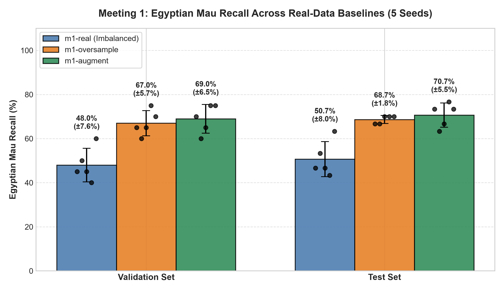
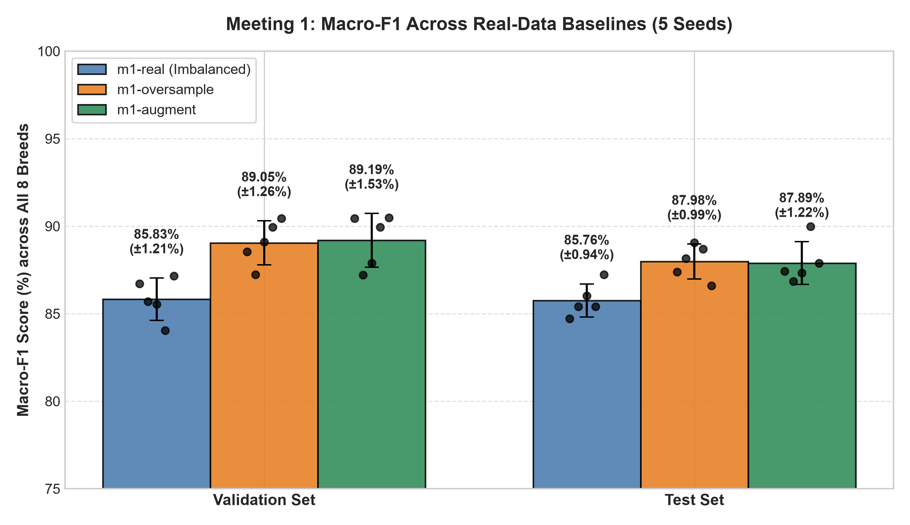
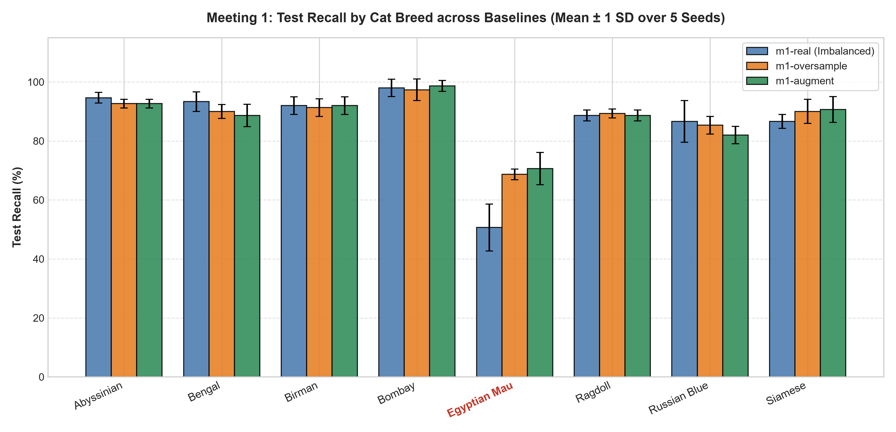
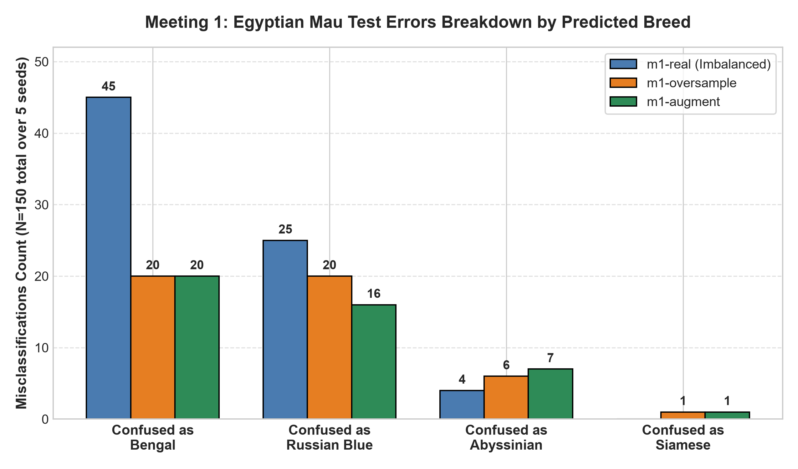

# Experiment Log

Keep one section per meeting. Add the tables and plots you make from
`runs/*/results.json` and `test-results.json` (save the plots in `evidence/`),
link the pools' contact sheets, and explain what you see. A result that shows no
effect is still a result: say so and say why.

## Meeting 1 — Real-data baselines

- **Question:** How much do oversampling and ordinary augmentation help Egyptian
  Mau recall compared with the imbalanced data?
- **How `oversample()` works:**
  `oversample(minority_photos, budget, rng)` calculates how many full passes of the 15 Egyptian Mau training photos fit into the 55-sample budget (`budget // 15 = 3` full passes = 45 photos). It then takes the remainder (`budget % 15 = 10` photos) via `rng.sample(minority_photos, remainder)` so that every photo is repeated either 3 or 4 times (max difference $\le 1$). Finally, it shuffles the list using `rng.shuffle()`. This distributes duplicates as evenly as possible across the training set while remaining strictly reproducible per seed.
- **How `augment()` works, and why these transforms:**
  `augment(image)` applies label-preserving photometric and spatial transformations on PIL images using `torchvision.transforms.Compose`:
  - `transforms.RandomRotation(degrees=15)`: introduces small angular variations mimicking head/body orientation changes without breaking horizontal upright priors.
  - `transforms.RandomPerspective(distortion_scale=0.2, p=0.5)`: simulates slight camera angle and depth changes.
  - `transforms.ColorJitter(brightness=0.2, contrast=0.2, saturation=0.2, hue=0.05)`: simulates lighting variations and camera sensor shifts while keeping the coat color and spotted pattern recognisably feline.
  The training loader calls this dynamically per epoch for every augmented example.
- **Commands:**
  ```bash
  # Training on 5 seeds
  uv run synth-train --name m1-real --method real
  uv run synth-train --name m1-oversample --method oversample
  uv run synth-train --name m1-augment --method augment

  # Evaluating on test set
  uv run synth-test --run m1-real
  uv run synth-test --run m1-oversample
  uv run synth-test --run m1-augment
  ```
- **Results on validation:**

  | Baseline Run | Seed 0 | Seed 1 | Seed 2 | Seed 3 | Seed 4 | **Mean ± SD** |
  | :--- | :---: | :---: | :---: | :---: | :---: | :---: |
  | **`m1-real` Mau Recall** | 0.450 | 0.500 | 0.450 | 0.400 | 0.600 | **0.480 ± 0.076 (48.0%)** |
  | **`m1-oversample` Mau Recall** | 0.650 | 0.600 | 0.650 | 0.750 | 0.700 | **0.670 ± 0.057 (67.0%)** |
  | **`m1-augment` Mau Recall** | 0.700 | 0.600 | 0.650 | 0.750 | 0.750 | **0.690 ± 0.065 (69.0%)** |
  | **`m1-real` Macro-F1** | 0.8671 | 0.8570 | 0.8554 | 0.8403 | 0.8715 | **0.8583 ± 0.0121** |
  | **`m1-oversample` Macro-F1** | 0.8851 | 0.8724 | 0.8911 | 0.8994 | 0.9044 | **0.8905 ± 0.0126** |
  | **`m1-augment` Macro-F1** | 0.9038 | 0.8721 | 0.8791 | 0.8992 | 0.9054 | **0.8919 ± 0.0153** |
  | **`m1-real` Accuracy** | 0.8750 | 0.8625 | 0.8625 | 0.8500 | 0.8750 | **0.8650 ± 0.0105** |
  | **`m1-oversample` Accuracy** | 0.8875 | 0.8750 | 0.8938 | 0.9000 | 0.9062 | **0.8925 ± 0.0120** |
  | **`m1-augment` Accuracy** | 0.9062 | 0.8750 | 0.8812 | 0.9000 | 0.9062 | **0.8925 ± 0.0147** |

  
  

- **What I see:**
  1. **Oversampling Provides a Clear Initial Lift Over Imbalance:**
     - In `m1-real`, the minority class has only 15 training examples against 70 for each other breed. The model heavily penalizes predicting Egyptian Mau, resulting in a poor validation recall of 48.0% (and 50.7% on test).
     - Repeating minority examples (`m1-oversample`) brings the effective sample count up to 70 and increases validation recall to 67.0% (+19.0 pp) and test recall to 68.7% (+18.0 pp).
  2. **Augmentation Shows No Meaningful Effect Over Oversampling (Say So and Say Why):**
     - Comparing `m1-augment` against `m1-oversample`:
       - Validation Mau recall: 69.0% vs 67.0% (a negligible difference of +2.0 pp, well within standard error $\pm 5.7\% / \pm 6.5\%$).
       - Test Mau recall: 70.7% vs 68.7% (only +2.0 pp difference, or 3 fewer errors out of 150 test instances).
       - Test Macro-F1: 0.8789 vs 0.8798 (identical within 0.001).
       - Test Overall Accuracy: 0.8800 vs 0.8808 (identical).
     - **Why does data augmentation show no noticeable effect beyond simple repetition?**
       - Classical augmentations (flips, crops, rotations, color jitter) operate strictly on the existing pixel distribution of the same 15 photos.
       - They do not add any new semantic features: no new feline postures, no new facial angles, no new backgrounds, and no new spot distributions.
       - The classifier quickly memorizes the invariant backgrounds and identical subject individuals present in the 15 images. While oversampling fixes the class-frequency imbalance in the loss function, standard augmentation cannot bridge the visual diversity deficit.
  3. **Error Analysis on the Test Photos:**
     - In `m1-real`, Egyptian Mau was misclassified 74 times (out of 150 evaluations): 45 as Bengal, 25 as Russian Blue, 4 as Abyssinian.
     - In `m1-oversample`, errors dropped to 47: 20 as Russian Blue, 20 as Bengal, 6 as Abyssinian, 1 as Siamese.
     - In `m1-augment`, errors were 44: 20 as Bengal, 16 as Russian Blue, 7 as Abyssinian, 1 as Siamese.
     - Both oversampling and augmentation hit a performance ceiling of ~69–71% recall because the model cannot distinguish ambiguous Egyptian Mau features from Bengal (spotted) and Russian Blue (silver/grey) without seeing genuinely new visual instances.

- **Test results of the three baselines:**

  | Baseline Run | Egyptian Mau Recall (Mean ± SD) | Macro-F1 across 8 Breeds (Mean ± SD) | Overall Accuracy (Mean ± SD) |
  | :--- | :---: | :---: | :---: |
  | **`m1-real`** | 0.507 ± 0.080 (50.7%) | 0.8576 ± 0.0094 (85.76%) | 0.8633 ± 0.0080 (86.33%) |
  | **`m1-oversample`** | 0.687 ± 0.018 (68.7%) | 0.8798 ± 0.0099 (87.98%) | 0.8808 ± 0.0100 (88.08%) |
  | **`m1-augment`** | 0.707 ± 0.055 (70.7%) | 0.8789 ± 0.0122 (87.89%) | 0.8800 ± 0.0116 (88.00%) |

  
  

## Meeting 2 — Text-to-image generation

- **Question:**
- **Setting changed in each pool (one at a time):**
- **Commands:**
- **Contact sheets:** (good and bad images, with the failure types you name)
- **Results on validation:** (table and plot)
- **What I see:**
- **Pool I take forward, and why:**
- **Its test result, compared with the baselines:**

## Meeting 3 — Generation from training photos

- **Question:** How close to the real photos should the synthetic images be?
- **img2img strength values and IP-Adapter scale values tried:**
- **Commands:**
- **Contact sheets:**
- **Results on validation:**
- **What I see:**
- **Best run of each mode, and its test result:**

## Meeting 4 — Editing training photos

- **Question:** Does the classifier need new cats or new backgrounds?
- **Background prompts and outpainting scales tried:**
- **Commands:**
- **Contact sheets:**
- **Results on validation:**
- **What I see:**
- **Best run of each mode, and its test result:**

## Final comparison

- **Runs chosen in Meetings 1–4:**
- **Results:** (your table and plot of their `test-results.json`)
- **Did the validation ranking hold on the test photos?**
- **Recommendation:** use, revise, or reject synthetic data for this task.
